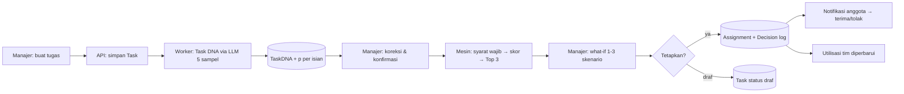

# 03 — ARCHITECTURE & Rencana Build

> Turunan dari 01-PRD. Prioritas: alur inti jalan stabil. ID task = ID di 04-TODO.
> **Fase sekarang: M0 Mockup frontend (tenggat Kamis, 22 Okt 2026).** Hanya folder `frontend/` yang dikerjakan; data contoh di seed, AI dan backend dipalsukan. Milestone M1 dan seterusnya didokumentasikan untuk tahap MVP.

## 1. Stack
| Lapisan | Pilihan | Alasan |
|---|---|---|
| Frontend | Next.js (App Router) + TypeScript strict + Tailwind CSS v4 | Wajib (proposal §3.1); App Router memisahkan area `(marketing)` dan `(app)` |
| Komponen UI | Shell & kelas CSS template Soft Op Dashboard, port persis dari K-DASP (`components/shell/`, `components/ui/index.tsx`, `globals.css`) | Keputusan user: tampilan harus sama persis dengan template (Q13) |
| Ikon | lucide-react, stroke 1.75 | Satu keluarga, sama dengan template (A1) |
| Font | Onest + JetBrains Mono via `next/font/google` (di-self-host saat build) | Template Soft Op Dashboard; A11 |
| Visualisasi data | Tanpa library: batang kapasitas & perbandingan sebelum/sesudah dibuat dengan elemen HTML + token | Datanya sederhana (rasio, batang); ponytail. Tambah library hanya bila Laporan (P23) butuh grafik tren |
| State mockup (M0) | React context + seed TypeScript di `src/lib/demo/`, tersimpan di memori (reset saat reload) + `sessionStorage` opsional | Tanpa backend; cukup untuk demo alur |
| Mesin keputusan (M0) | TypeScript murni di `src/lib/engine/` (syarat wajib, skor, what-if) + Vitest | Demo memakai logika yang sama dengan spesifikasi; nanti dipindah ke Python dengan test yang sama |
| Backend & API (M1+) | Django 5 + Django REST Framework | Wajib (proposal) |
| Mesin keputusan (M3+) | Python + Google OR-Tools (CP-SAT untuk alokasi batch) | Wajib (proposal); R12 |
| AI (M2+) | LLM dengan structured output (JSON schema), 5 sampel per tugas untuk probabilitas; atau decision model (mis. Jev) untuk primitif ya/tidak & score | Lihat §5; penyedia diputuskan di AI1 dari eval biaya & akurasi (00-BRIEF P5) |
| Database (M1+) | PostgreSQL 16 | Wajib (proposal) |
| Auth (M1+) | Session Django + CSRF (cookie httpOnly, SameSite=Lax), peran manajer/anggota/admin | Bawaan Django, tanpa dependency tambahan |
| Animasi landing | Menunggu jawaban user (00-BRIEF P2). Default: transisi CSS dengan token gerak | Lenis + Motion Primitives hanya bila user memilih "rekomendasi" |
| Hosting | M0: hosting Next.js gratis (mis. Vercel Hobby) `[asumsi]`; bukan static export karena tugas yang dibuat saat demo butuh rute dinamis `/tugas/[id]`. MVP: Docker Compose + VPS + Nginx + HTTPS | Proposal §3.1 |
| Package manager | npm (frontend), uv atau pip + venv (backend) `[asumsi]` | Default |

## 2. Perintah Verifikasi & Setup
| Cek | Perintah |
|---|---|
| Install FE | `cd frontend && npm install` |
| Dev FE | `npm run dev` (http://localhost:3000) |
| Token desain | `npx -p @google/design.md designmd export --format css-tailwind ../docs/08-DESIGN.md > src/styles/theme.css` |
| Test FE | `npm run test` (Vitest) |
| Build FE | `npm run build` |
| Typecheck FE | `npx tsc --noEmit` |
| Lint FE | `npm run lint` |
| Dead code FE | `npx knip` |
| Install BE *(M1+)* | `cd backend && uv sync` |
| Dev BE *(M1+)* | `uv run python manage.py runserver` · DB: `docker compose up -d db` |
| Migrasi / seed *(M1+)* | `uv run python manage.py migrate && uv run python manage.py seed_demo` |
| Test BE *(M1+)* | `uv run pytest` |
| Lint & dead code BE *(M1+)* | `uv run ruff check . && uv run vulture apps` |
| Eval AI *(M2+)* | `uv run python eval/run_task_dna.py` → akurasi per primitif |
| Alur inti | Manual: Masuk (demo manajer) → Buat tugas "Integrasi autentikasi" → konfirmasi Task DNA → pilih kandidat #1 → simulasi → Tetapkan → cek utilisasi Bima naik di Dasbor, Tim, Kapasitas. M1+: test e2e Playwright `[asumsi]` |

## 3. Model Data
> Entitas sama dengan matriks entitas 01-PRD §5c. Di M0, bentuk yang sama ditulis sebagai tipe TypeScript di `src/lib/demo/types.ts`.

| Entitas | Field kunci | Relasi | Sumber |
|---|---|---|---|
| Organization | id, name, timezone (Asia/Jakarta), default_hours_per_day, period_type (mingguan) | 1-n User, Member, Project | P6, P28 |
| User | id, email, password_hash, name, role (admin/manajer/anggota), is_active | n-1 Organization; 0-1 Member | P5-P8, P31 |
| Member (Work Twin) | id, user_id?, display_name, job_role, weekly_limit_hours, preferences (jsonb: jenis tugas disukai/dihindari), is_active | n-n Competency via MemberCompetency; 1-n Availability, Assignment | P18, P19, P27, impor CSV |
| Competency | id, name, category, aliases[] | katalog per organisasi | P30 |
| MemberCompetency | member_id, competency_id, level (0-3), source (klaim/verifikasi/riwayat), verified_by, updated_at | | P19, P27 |
| Availability | member_id, period_start, period_end, available_hours, leave_dates[] | | P25, P21 |
| Project | id, name, client, due_date, archived | 1-n Task | P20 |
| Task | id, project_id, title, description, due_date, priority (rendah/normal/tinggi), status, created_by, created_at, archived_at | 1-n TaskDNA (versi), 0-n TaskDependency, 0-n Assignment | P12, P11, P16 |
| TaskDNA | id, task_id, version, required_competencies (jsonb: [{competency_id, level, p, source_quote}]), effort_size, effort_hours, complexity, confidence_flags, extracted_by (model@versi), prompt_version, corrected_by, confirmed_at | | P13 |
| TaskDependency | task_id, depends_on_task_id, p, confirmed | | P13 |
| RecommendationRun | id, task_id, task_dna_version, preset, weights (jsonb), filtered_out (jsonb: member_id + syarat gagal), candidates (jsonb: member_id, score, factors{K,C,A,R,F}, rank), created_at | | P14 |
| Assignment | id, task_id, member_id, hours, status (menunggu jawaban/diterima/ditolak/dibatalkan), response_reason, assigned_at | | P15, P17, P26 |
| Decision (log, tidak bisa diubah) | id, task_id, run_id, outcome (ditetapkan/ditolak), chosen_member_id (kosong bila ditolak), chosen_rank (1-3 atau null = override/ditolak), reason_code (override: klien/pengembangan/info/lainnya; tolak: tidak-sesuai/kebutuhan/tunda/lainnya), reason_text, decision_ms (Tp), conflicts_seen, decided_by, decided_at | Tp dan konflik hanya dihitung dari keputusan ditetapkan | P14, P15 → P22, P23 |
| BaselineMeasurement | id, org_id, decision_ms, measured_at, note | Tb dari observasi | P23 |
| Notification | id, user_id, kind, payload, read_at | | P34 |
| Subscription *(Could)* | org_id, plan, seats, trial_ends_at | | P32 |

**Aturan turunan (dihitung, tidak disimpan):** utilisasi = Σ jam Assignment aktif di periode ÷ available_hours; status "data lengkap" = kompetensi ≥ 1 dan Availability periode ini ada.

## 4. Integrasi & Alur Sistem
- **Integrasi pihak ketiga:** penyedia LLM (Task DNA, M2+); email transaksional untuk undangan & reset sandi (M1+, mis. SMTP) `[asumsi]`. Tidak ada integrasi lain di MVP.
- **Alur sistem (MVP):**

- **Alur M0 (mockup):** semua langkah di atas berjalan di browser. "Analisis" Task DNA menampilkan skeleton 1,2 detik lalu memuat hasil dari seed; mesin keputusan TS menghitung sungguhan dari seed.
- **Keamanan & privasi dasar:**
  - Validasi input di batas API (serializer DRF) dan di form (pesan error per field).
  - Otorisasi per peran dan per organisasi di setiap query (multi-tenant dengan filter `organization_id`; test wajib bahwa data organisasi lain tidak bocor).
  - Secret di `.env` (tidak di-commit); `.env.example` tanpa nilai asli.
  - Data Work Twin = data pribadi pekerja (UU PDP, R13): tujuan pemrosesan ditulis di P3; anggota bisa melihat data apa yang dilihat manajer (P27); data jam kerja tidak dipakai untuk penilaian kinerja (aturan produk, R7); penghapusan atas permintaan.
  - Teks tugas yang dikirim ke LLM: tidak berisi data pribadi anggota (hanya teks tugas + katalog kompetensi).
  - Log keputusan tidak bisa diubah (audit).

## 5. Peta Panggilan AI
> AI dipanggil oleh kode sebagai primitif kecil; kode yang memutuskan. Pola lengkap: `docs/AI-PRIMITIVES.md`. **M0 tidak memanggil AI** (hasil dari seed).

| Titik keputusan | Primitif | Input (JSON) | Output | Ambang: otomatis / review / buang | Eskalasi |
|---|---|---|---|---|---|
| Kompetensi dibutuhkan | ya/tidak + p, satu pertanyaan per kompetensi katalog (batch per id) | `{"task":{"title","description"},"items":[{"id":"c_12","name":"Backend API"}]}` | p per kompetensi + kutipan kalimat sumber | ≥ 0,8 / 0,6-0,8 (ditandai ragu) / < 0,6 | Manajer wajib melihat isian ragu sebelum konfirmasi |
| Level minimum | score 0-3, hanya untuk kompetensi lolos | sama + `competency_id` | level median 5 sampel + sebaran | sebaran ≤ 1 level → otomatis; > 1 → ragu | Manajer |
| Ukuran upaya | choice S/M/L/XL | `{"task":{...}}` | ukuran mayoritas + p | p ≥ 0,6 / < 0,6 ragu | Riwayat aktual menimpa bila ≥ 5 tugas serupa |
| Kompleksitas | score 0-3 | `{"task":{...}}` | skor median | sebaran ≤ 1 → otomatis | Manajer |
| Dependensi | ya/tidak + p per kandidat tugas (maks 10, dipilih dengan kemiripan kata kunci di proyek sama) | `{"task":{...},"items":[{"id":"t_31","title"}]}` | p per tugas | ≥ 0,8 / 0,5-0,8 disarankan / < 0,5 buang | Manajer konfirmasi |

- **Penyedia:** diputuskan di task AI1 (00-BRIEF P5). Kandidat: (a) LLM kecil dengan structured output + 5 sampel (temperature 0,7) → p = proporsi; (b) decision model Jev (`POST https://api.typesafe.ai/v1/systemone`, klien di `docs/AI-PRIMITIVES.md` §6) untuk primitif ya/tidak & score dengan probabilitas bawaan. Confidence yang ditulis model sendiri **tidak dipakai** `[riset: R10]`. Fallback: bila AI gagal/timeout 15 dtk → form Task DNA kosong untuk diisi manual (alur tetap jalan).
- **Diolah saat data masuk:** Task DNA dibuat sekali saat tugas disimpan dan disimpan sebagai versi; rekomendasi dan simulasi tidak memanggil AI.
- **Paralel & cache:** satu batch request per tugas; cache per hash (judul+deskripsi+versi katalog+versi prompt).
- **Ambang disimpan di:** `backend/apps/taskdna/thresholds.py` (config, bisa per organisasi kemudian), bukan di prompt.
- **Versi dikunci:** `extracted_by = "{model}@{versi}"`, `prompt_version = "taskdna-v1"`, ditulis di setiap TaskDNA.
- **Eval:** 40 tugas berlabel (deskripsi realistis software house: backend, frontend, UI/UX, QA, data, DevOps) di `backend/eval/task_dna_cases.jsonl`. Target: recall kompetensi ≥ 0,85, presisi ≥ 0,8, ukuran upaya tepat ±1 kelas ≥ 0,85. Uji robustness: urutan katalog diacak dan sinonim → hasil sama. Penilai deterministik (bandingkan set kompetensi & kelas).
- **Biaya & latensi:** dicatat dari `usage` per panggilan; target < 8 detik per tugas dan di bawah Rp100 per tugas `[asumsi]`. Angka nyata masuk 01-PRD struktur biaya.

## 6. Rencana Build
Milestone → task ≤ ½ hari. Pemilik "—" sampai peran dibagi (00-BRIEF P4).

### M0 — Mockup frontend (16-22 Okt 2026)
Urutan disusun supaya alur inti bisa didemokan paling cepat; task bertanda ∥ bisa dikerjakan paralel oleh anggota berbeda setelah T2-T3 selesai.

| ID | Task | Pemilik | Fitur | Kriteria selesai |
|---|---|---|---|---|
| T1 | Scaffold `frontend/` (Next.js TS strict, Tailwind v4, ESLint, Vitest, knip), font Onest + JetBrains Mono, export token 08-DESIGN ke `theme.css`, hapus boilerplate, pasang favicon & ikon dari `docs/brand/export/symbol/` + logo di sidebar | — | — | `lint`, `tsc`, `test`, `build`, `knip` hijau; halaman kosong memakai token kanvas & font |
| T2 | App shell area `(app)`: port shell K-DASP (sidebar, top bar, footer, drawer dialog), top bar (judul, periode), stepper alur inti; kerangka rute semua halaman Must + Should dengan komponen Placeholder | — | — | Semua rute di 01-PRD §5 bisa dibuka; navigasi keyboard & drawer mobile lulus aturan sidebar |
| T3 | Seed demo + tipe: 6 anggota (Ayu Pramesti, Bima Pradana, Citra Maheswari, Dimas Saputra, Nadia Putri, Rafi Ramadhan), katalog 14 kompetensi, 8 tugas, ketersediaan 28 Sep-2 Okt 2026 (32 jam), 3 Task DNA hasil "AI" dengan p per isian; store React context | — | F3 | Data sama dengan prototipe proposal; tipe sesuai §3 |
| T4 | Engine: syarat wajib + skor + 4 preset + alasan dari faktor (TS murni) | — | F4 | Vitest: kandidat cuti tersaring, level kurang tersaring, preset mengubah peringkat, alasan sesuai angka |
| T5 | Engine: what-if (utilisasi sebelum/sesudah, konflik tenggat ≤ 1 hari, utilisasi ≥ 90%, dependensi), skenario bagi 2 orang | — | F5 | Vitest untuk tiap jenis konflik |
| T6 ∥ | P10 Dasbor (pola Monitor): 4 kartu metrik, kapasitas anggota (total + per anggota), perlu penugasan, catatan tinjau | — | F8 | Semua state; angka dari store |
| T7 ∥ | P11 Daftar tugas: tabel + filter status/prioritas + cari | — | F1 | Kosong/filter tanpa hasil; angka rata kanan |
| T8 ∥ | P12 Buat tugas: form + validasi + simpan draf | — | F1 | Kriteria F1; error per field |
| T9 | P13 Tinjau Task DNA: skeleton "menganalisis", isian dengan tanda yakin/ragu + kutipan sumber, edit, konfirmasi | — | F2 | Isian ragu wajib dibuka sebelum konfirmasi; state gagal → isi manual |
| T10 | P14 Rekomendasi: kartu sorotan #1, 3 kartu kandidat dengan kontribusi faktor, daftar tersaring (dilipat), ganti preset | — | F4 | Kriteria F4; state "tidak ada kandidat lolos" |
| T11 | P15 Simulasi: perbandingan sebelum → sesudah per skenario, konflik, sebaran beban, dialog Tetapkan (alasan wajib bila di luar Top 3), simpan draf | — | F5, F6 | Kriteria F5-F6; dialog native dengan focus trap & Esc |
| T12 | Pembaruan kapasitas setelah tetapkan + P16 Detail tugas dengan log keputusan | — | F6, F7 | Utilisasi berubah di P10, P18, P21; log tampil |
| T13 ∥ | P18 Tim + P19 Profil kerja anggota | — | F3 | Status kelengkapan; kompetensi + sumber |
| T14 ∥ | P21 Kapasitas | — | F7 | Ambang mendekati penuh 85%; ketersediaan belum diisi |
| T15 ∥ | P5 Masuk (pilih peran demo) + P36/P38 | — | F9 | Form valid; masuk demo manajer menuju P10 |
| T16 | Landing: token Area Landing + section wrapper + navbar + footer (setelah inspirasi masuk) | — | F10 | Lihat LANDING-PAGE §6 |
| T17-T24 | Landing section L1-L8 (satu task per section) + `content/landing.ts` | — | F10 | Larangan AI slop; reduced-motion |
| T25 | Uji responsif 375/768/1440, aksesibilitas (keyboard, kontras, focus), konten realistis, A1-A13; perbaikan | — | — | Checklist 07-RULES §8 lulus |
| T26 | Deploy preview + video rekaman alur inti (cadangan demo) + latihan script 05-PITCH | — | — | Link/berkas siap dikumpulkan 22 Okt |

### M1 — Backend dasar (setelah lomba, ±minggu 1-2 MVP)
| ID | Task | Pemilik | Fitur | Kriteria selesai |
|---|---|---|---|---|
| B1 | Scaffold `backend/` Django + DRF, `docker-compose.yml` (PostgreSQL), health-check `/api/health`, ruff, pytest, vulture | — | — | Semua cek hijau; DB terkoneksi |
| B2 | Model Organization, User, Member, Competency, MemberCompetency, Availability + migrasi + admin | — | F3 | Test model & batas organisasi |
| B3 | Auth sesi + peran + endpoint masuk/keluar/me | — | F9 | Test akses lintas organisasi ditolak |
| B4 | Model Project, Task, TaskDNA, TaskDependency + API CRUD tugas | — | F1 | Test validasi |
| B5 | `seed_demo` (data sama dengan seed M0) | — | — | Seed idempoten |
| B6 | API Work Twin (tim, profil, ketersediaan, impor CSV) | — | F3, F12 | Error per baris CSV |

### M2 — Task DNA (AI)
| ID | Task | Pemilik | Fitur | Kriteria selesai |
|---|---|---|---|---|
| AI1 | Eval set 40 tugas berlabel + skrip akurasi per primitif; bandingkan 2 penyedia (biaya, latensi, akurasi) dan putuskan | — | F2 | Hasil di Q&A Keputusan |
| AI2 | Klien penyedia + primitif kompetensi (ya/tidak batch) + level (score) | — | F2 | Target eval tercapai |
| AI3 | Primitif ukuran upaya, kompleksitas, dependensi + ambang di config + fallback manual | — | F2 | Uji robustness lulus |
| AI4 | Endpoint analisis + versi TaskDNA + koreksi manajer | — | F2 | Versi tercatat |

### M3 — Mesin keputusan Python
| ID | Task | Pemilik | Fitur | Kriteria selesai |
|---|---|---|---|---|
| E1 | Port engine TS ke Python (syarat wajib, skor, preset, alasan) dengan kasus test yang sama | — | F4 | Hasil identik dengan engine TS untuk seed |
| E2 | What-if Python + RecommendationRun + Decision log (Tp) | — | F5, F6 | Test |
| E3 | Alokasi batch OR-Tools CP-SAT | — | F15 | 30×30 < 5 dtk; tugas tak feasible dijelaskan |

### M4 — Integrasi & sisi anggota
| ID | Task | Pemilik | Fitur | Kriteria selesai |
|---|---|---|---|---|
| I1 | Ganti store demo FE dengan klien API (mode demo tetap ada untuk presentasi) | — | — | Alur inti jalan ke server |
| I2 | P24-P27 sisi anggota + notifikasi | — | F11, F16 | Terima/tolak memperbarui status & notifikasi manajer |
| I3 | P9 onboarding + impor CSV | — | F12 | ≤ 10 menit tim 15 orang |
| I4 | P22 Riwayat keputusan + P23 Laporan dampak + isi Tb | — | F14 | 4 indikator tampil |
| I5 | Pengaturan P28-P31, P33 | — | F13 | — |
| I6 | Halaman Should sisanya (P2, P3, P6-P8, P17, P20, P34) | — | — | — |

### M5 — Rilis pilot
| ID | Task | Pemilik | Fitur | Kriteria selesai |
|---|---|---|---|---|
| R1 | Docker image FE + BE, Nginx + HTTPS di VPS, backup DB harian | — | — | Dapat diakses publik dengan HTTPS |
| R2 | Uji kegunaan 3-5 PM + perbaikan | — | — | Temuan dicatat |
| R3 | Pilot 1 tim + ukur H1-H5 | — | — | Laporan pilot |

## 7. Risiko & Cadangan
| Risiko | Cadangan |
|---|---|
| Mockup tidak selesai 22 Okt | Urutan T1-T12 dulu (alur inti); landing dan halaman lain tetap placeholder rapi; video rekaman sebagai cadangan |
| Inspirasi landing terlambat | Landing dibangun dari section draf 01-PRD §5d dengan token bersama; restyle setelah inspirasi masuk |
| Hasil AI Task DNA tidak akurat | Ambang ketat + wajib tinjau isian ragu + isi manual; eval sebelum rilis |
| Data Work Twin kosong (cold start) | Impor CSV, anggota isi sendiri, status "belum lengkap" yang mencolok, pengingat satu klik |
| Anggota merasa diawasi | Tidak ada pelacakan aktivitas; teks "jam kerja, bukan ukuran produktivitas"; anggota melihat data dirinya (R7) |
| Bobot skor dipertanyakan juri | Preset terbuka + kalibrasi dari data override + alasan per faktor (R6, R11) |
| Perbedaan hasil engine TS vs Python | Kasus test bersama (JSON fixture) dipakai kedua sisi |
| Kebocoran data antar organisasi | Filter organisasi di semua query + test khusus |

## 8. Q&A Keputusan
| # | Pertanyaan | Keputusan | Tanggal |
|---|---|---|---|
| Q1 | Mockup dulu atau MVP penuh? | Mockup frontend dengan data contoh untuk 22 Okt; engine TS sungguhan supaya demo bisa diubah-ubah | 2026-10-16 |
| Q2 | Apakah LLM ikut memilih penerima tugas? | Tidak. LLM hanya mengurai tugas; pemilihan oleh kode deterministik + manajer (proposal §3.1, R6) | 2026-10-16 |
| Q3 | Dari mana probabilitas AI? | Mayoritas 5 sampel atau probabilitas bawaan decision model; bukan confidence yang ditulis model (R10) | 2026-10-16 |
| Q4 | OR-Tools untuk apa? | Alokasi banyak tugas sekaligus (CP-SAT). Rekomendasi per tugas cukup syarat wajib + skor (R12) | 2026-10-16 |
| Q5 | Alasan rekomendasi ditulis LLM? | Tidak; template kalimat dari kontribusi faktor, supaya selalu konsisten dengan angka (R11) | 2026-10-16 |
| Q6 | Sisi karyawan masuk MVP? | Versi minimal (ketersediaan, terima/tolak, status, klaim kompetensi); di M0 hanya placeholder | 2026-10-16 |
| Q7 | Template desain | Soft Op Dashboard, warna merek teal "Selaras" (#0F766E) | 2026-10-16 |
| Q8 | Library grafik? | Tidak di M0; batang dibuat HTML + token | 2026-10-16 |
| Q9 | Animasi landing | Menunggu user (00-BRIEF P2) | terbuka |
| Q10 | Next 16 `cacheComponents` aktif: bagaimana sidebar membaca rute aktif? | Komponen yang memanggil `usePathname` (menu, breadcrumb) dibungkus `<Suspense>` dengan fallback markup yang sama (wajib di rute ber-param dinamis, docs bawaan Next `use-pathname.md`) | 2026-10-16 |
| Q11 | vitest 5 bentrok `@types/node` 20 dari scaffold | `@types/node` dinaikkan ke ^22 sesuai runtime Node 22 (tanpa `--force`) | 2026-10-16 |
| Q12 | shadcn, sidebar-21st, framer-motion | Dilepas setelah Q13; dependency runtime tinggal next, react, react-dom, lucide-react | 2026-10-16 |
| Q13 | Tampilan tidak sama dengan template K-DASP | Shell dipindah ke port persis kode K-DASP (CSS + komponen), diverifikasi dengan screenshot berdampingan 1440/768/375. Instruksi langsung user menang atas aturan global "sidebar selalu sidebar-21st" | 2026-10-16 |
| Q14 | Bagaimana "menolak rekomendasi" (proposal §3.2) dicatat? | Tombol "Tolak rekomendasi" di P14 dengan alasan wajib; tercatat sebagai Decision `ditolak` tanpa penerima. Menurunkan tingkat penerimaan, tidak ikut rata-rata Tp maupun hitungan konflik. Statistik di `lib/engine/metrics.ts` (Vitest) | 2026-10-16 |
| Q15 | Halaman galat server `/500` di App Router? | Memakai `app/error.tsx` (error boundary dengan "Coba lagi"), bukan rute `/500` terpisah | 2026-10-16 |
| Q16 | Katalog kompetensi di Pengaturan membingungkan (user: pengaturan = urusan sistem) | Dipindah ke tab di halaman Tim (`/tim/kompetensi`). Pengaturan tinggal Umum, Aturan rekomendasi, Anggota & peran, Tagihan. Pola serupa: Runn menaruh Skills di menu Manage, terpisah dari Settings | 2026-10-16 |
| Q17 | Bagaimana manajer melihat keahlian semua anggota sekaligus? | Tab "Peta keahlian" di Tim (`/tim/keahlian`, P40): matriks + kompetensi rawan = dikuasai ≤ 1 anggota di level Mandiri ke atas (truck factor, R4). Fungsi murni `atRiskCompetencies` di `lib/engine/skills.ts` (Vitest). Menampilkan level kompetensi, bukan kinerja | 2026-10-16 |
| Q18 | Heatmap beban harian (pola GitHubActivity 21st.dev) di P21? | Dicoba lalu dihapus total atas permintaan user 16 Okt (komponen, engine `daily.ts`, test, CSS). Jangan ditambahkan lagi tanpa permintaan; komponen aslinya juga tidak cocok dipasang apa adanya (butuh `motion`, warna hex, API GitHub) | 2026-10-16 |
| Q19 | Tampilan Proyek memakai komponen "Glass Folder Cards" (21st.dev)? | Ya, atas permintaan user, di-port ke `components/ui/glass-folder.tsx`: warna motif cair dibaca dari token merek saat runtime, semua warna CSS lewat token/`color-mix`, font aplikasi, teks Indonesia. Isi folder = tugas terbuka proyek (tiap lembar tautan ke tugas); menu ⋯ = Buka folder, Lihat detail proyek, Buat tugas. Dibuang karena tidak dipakai: tone gelap, gambar kustom, tombol + (menambah file palsu). Tanpa dependency baru | 2026-10-17 |
| Q20 | Animasi fluid + gaya kaca ke seluruh halaman? | Pilihan user: aksen kaca terarah. Kaca hanya di lapisan melayang (top bar, dialog, drawer, menu); kartu data tetap solid. Motif cair (`components/ui/fluid-art.tsx`, dipakai juga folder) di kartu sorotan dengan lapisan gelap yang menjaga kontras ≥ 4,5:1. Gerak fluid CSS dengan `--spring`: masuk bertahap, hover kartu bertaut, batang tumbuh, dialog pegas; mati saat reduced-motion. Tanpa dependency | 2026-10-17 |
| Q21 | Sub-halaman Tim dan Pengaturan memakai pola "BranchedMenu" (React Bits)? | Ya, atas permintaan user, sebagai sub-menu di sidebar (`NavBranch` di app-shell + `SUBNAV`/`activeSub` di `lib/nav.ts`, Vitest). Tanpa dependency HugeIcons (ikon tetap lucide), warna lewat token. Tab di halaman Tim dihapus. Cabang terbuka hanya di halaman Tim, `inert` saat terlipat, disembunyikan saat sidebar ciut | 2026-10-17 |
